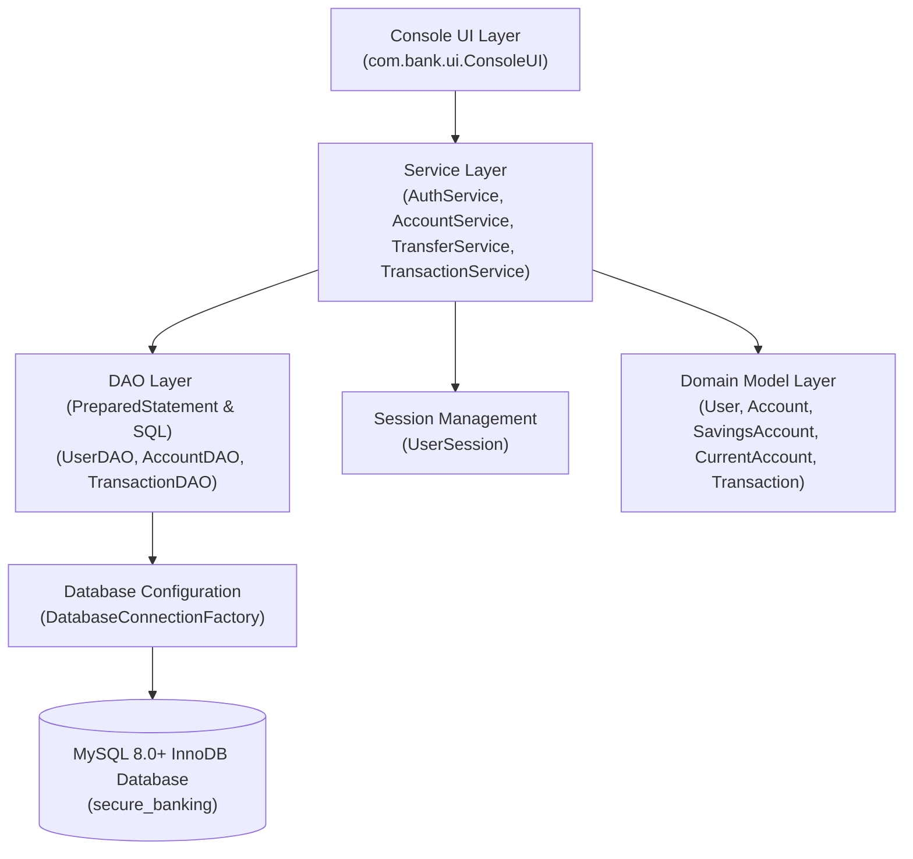
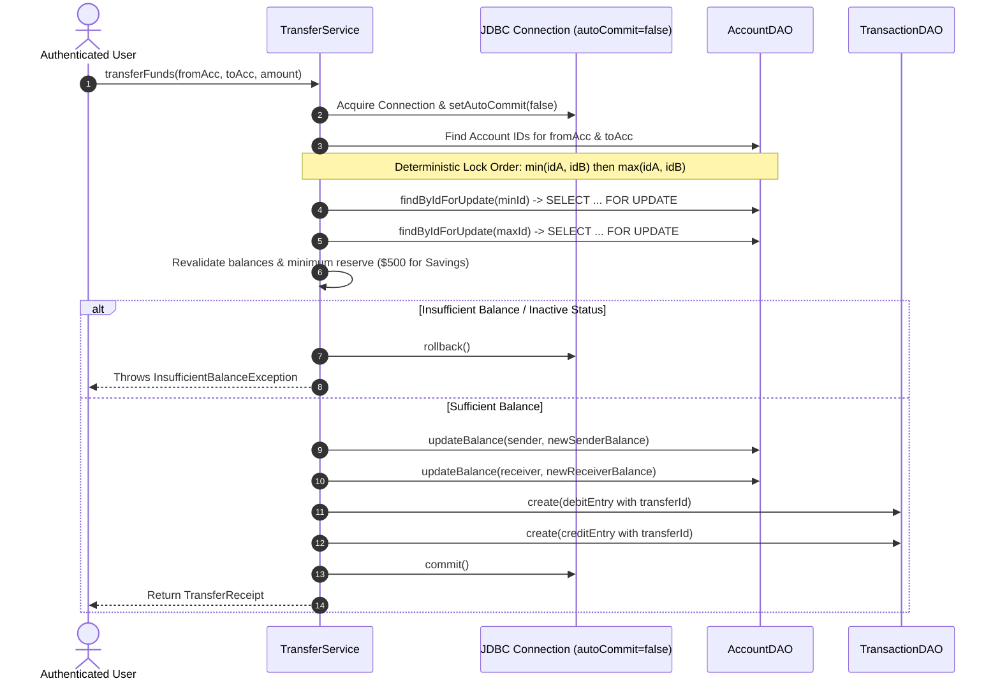

# Secure Online Banking & Wallet System

A high-performance, console-based core banking application built with **Java 17+**, **JDBC**, **MySQL 8+**, and **BCrypt**. The system provides enterprise-grade fund transfers with deterministic row-level locking, atomic balance updates, dual-ledger audit records, and strict transaction rollback.

---

## Table of Contents
- [1. Technology Stack](#1-technology-stack)
- [2. System Architecture](#2-system-architecture)
- [3. Database Design & Schema](#3-database-design--schema)
- [4. High-Priority Concurrency & Transfer Engine](#4-high-priority-concurrency--transfer-engine)
- [5. Features & Business Rules](#5-features--business-rules)
- [6. Setup & Execution Guide](#6-setup--execution-guide)
- [7. Running the Test Suite](#7-running-the-test-suite)
- [8. Sample Console Walkthrough](#8-sample-console-walkthrough)
- [9. GitHub Repository Setup](#9-github-repository-setup)
- [10. Technical Decisions & Limitations](#10-technical-decisions--limitations)

---

## 1. Technology Stack

- **Language:** Java 17 LTS (Core Java, OOP, Encapsulation, Polymorphism)
- **Database:** MySQL 8.0+ (InnoDB Storage Engine)
- **Persistence:** JDBC with parameterized `PreparedStatement` and connection lifecycle management
- **Security:** BCrypt password hashing (`jBCrypt 0.4`, 12 work rounds)
- **Monetary Precision:** `java.math.BigDecimal` (Scale 2, `RoundingMode.HALF_UP`)
- **Build System:** Apache Maven 3.9+ with `maven-assembly-plugin` for executable fat-JAR packaging
- **Testing:** JUnit 5 (`junit-jupiter 5.10.2`) with in-memory H2 database in MySQL compatibility mode for CI/CD test automation

> **Note:** Built purely with Core Java and JDBC. No Spring, Hibernate, or web frameworks are used.

---

## 2. System Architecture

The application adopts a clean, layered architectural pattern with strict boundary separation:



### Layer Responsibilities
- **`com.bank.ui` (`ConsoleUI`):** Handles interactive CLI menus, input validation, tabular report formatting, and user feedback.
- **`com.bank.service` (`AuthService`, `AccountService`, `TransferService`, `TransactionService`, `UserSession`):** Enforces business logic, authentication, ownership validation, and coordinates multi-step database transactions.
- **`com.bank.dao` (`UserDAO`, `AccountDAO`, `TransactionDAO`):** Encapsulates parameterized SQL statements, result set mapping, and dual-connection signatures supporting caller-managed transactions.
- **`com.bank.config` (`DatabaseConnectionFactory`):** Manages connection lifecycle using environment variables, external configuration files, or classpath defaults. Never shares mutable connections across threads.
- **`com.bank.model`:** Encapsulates domain entities. An abstract base `Account` enables polymorphic rules between `SavingsAccount` and `CurrentAccount`.
- **`com.bank.exception`:** Custom checked exceptions (`BankingException`, `InsufficientBalanceException`, `AccountNotFoundException`, `UnauthorizedAccessException`, `AuthenticationException`, `ValidationException`).

---

## 3. Database Design & Schema

The database `secure_banking` uses the **InnoDB** storage engine to support ACID transactions, strict foreign keys (`ON DELETE RESTRICT`), and pessimistic locking.

```
+-------------------------------------------------------------+
|                            users                            |
+-------------------------------------------------------------+
| user_id (PK, BIGINT, AUTO_INCREMENT)                        |
| full_name (VARCHAR(100), NOT NULL)                          |
| email (VARCHAR(100), NOT NULL, UNIQUE)                      |
| password_hash (VARCHAR(255), NOT NULL)                      |
| created_at (TIMESTAMP, DEFAULT CURRENT_TIMESTAMP)           |
+-------------------------------------------------------------+
                              | 1
                              |
                              | N
+-------------------------------------------------------------+
|                           accounts                          |
+-------------------------------------------------------------+
| account_id (PK, BIGINT, AUTO_INCREMENT)                     |
| account_number (VARCHAR(20), NOT NULL, UNIQUE)              |
| user_id (FK -> users.user_id, RESTRICT)                     |
| account_type (VARCHAR(20), CHECK IN 'SAVINGS', 'CURRENT')    |
| balance (DECIMAL(19, 2), NOT NULL, CHECK balance >= 0.00)   |
| status (VARCHAR(20), CHECK IN 'ACTIVE', 'SUSPENDED', etc.)  |
| created_at (TIMESTAMP, DEFAULT CURRENT_TIMESTAMP)           |
+-------------------------------------------------------------+
                              | 1
                              |
                              | N
+-------------------------------------------------------------+
|                         transactions                        |
+-------------------------------------------------------------+
| transaction_id (PK, BIGINT, AUTO_INCREMENT)                 |
| account_id (FK -> accounts.account_id, RESTRICT)            |
| transfer_id (VARCHAR(64), NULL, INDEXED)                    |
| transaction_type (VARCHAR(20), NOT NULL)                    |
| amount (DECIMAL(19, 2), NOT NULL, CHECK amount > 0.00)      |
| description (VARCHAR(255), NULL)                            |
| created_at (TIMESTAMP, DEFAULT CURRENT_TIMESTAMP)           |
+-------------------------------------------------------------+
```

DDL is maintained in [`src/main/resources/db/schema.sql`](src/main/resources/db/schema.sql).

---

## 4. High-Priority Concurrency & Transfer Engine

Financial fund transfers require absolute data integrity and zero tolerance for phantom money creation or deadlocks.



### Critical Concurrency Protections:
1. **Deterministic Lock Ordering:**
   When User 1 transfers from Account 5 to Account 12 while User 2 simultaneously transfers from Account 12 to Account 5, standard row locking can cause a circular wait deadlock. `TransferService` sorts the account IDs:
   ```java
   long firstLockId = Math.min(fromAccount.getAccountId(), toAccount.getAccountId());
   long secondLockId = Math.max(fromAccount.getAccountId(), toAccount.getAccountId());
   accountDAO.findByIdForUpdate(conn, firstLockId);
   accountDAO.findByIdForUpdate(conn, secondLockId);
   ```
   Both threads always acquire lock `5` before lock `12`, completely eliminating deadlock conditions.
2. **Post-Lock Balance Revalidation:**
   Balances are re-checked *after* obtaining exclusive row locks, preventing race conditions and overspending during concurrent withdrawals.
3. **Atomic Dual Ledger Entries:**
   Every transfer creates two records (`TRANSFER_DEBIT` and `TRANSFER_CREDIT`) linked by a shared UUID `transferId` (`TXF-...`) inside the same database transaction.
4. **Complete Rollback:**
   If any update fails, `conn.rollback()` restores the initial state completely.

---

## 5. Features & Business Rules

### Authentication & Sessions
- Registration validates full name, email uniqueness, and password complexity (minimum 8 characters, letters, and numbers).
- Password hashed with BCrypt 12 work rounds (`$2a$12$...`).
- Generic error messages ("Invalid email or password") prevent user enumeration.
- Authenticated `UserSession` tracks logged-in user state.

### Account Management
- **Savings Account:** Enforces a minimum reserve balance of **$500.00**. Withdrawals or transfers dropping the balance below $500.00 are rejected.
- **Current Account:** Allows withdrawals down to **$0.00** with no minimum balance penalty.
- Unique account numbers generated: `SA-XXXXXX` (Savings) and `CA-XXXXXX` (Current).
- Strict ownership verification for every account operation: users can only view, deposit, withdraw, or transfer from accounts they own.

### Transaction History & Statements
- Full statement retrieval with tabular format.
- Multi-criteria filtering by transaction type (`DEPOSIT`, `WITHDRAWAL`, `TRANSFER_DEBIT`, `TRANSFER_CREDIT`) and date range (`YYYY-MM-DD`).

---

## 6. Setup & Execution Guide

### Prerequisites
- **Java 17+** (JDK 17 or higher)
- **MySQL 8.0+**
- **Git**

### Step 1: Database Setup
Log in to your MySQL terminal and run the schema initialization script:
```sql
mysql -u root -p < "src/main/resources/db/schema.sql"
```

### Step 2: Configure Database Credentials
You can provide credentials via environment variables or a local `db.properties` file:

**Option A: Environment Variables**
```bash
# Windows PowerShell
$env:DB_URL="jdbc:mysql://localhost:3306/secure_banking?useSSL=false&allowPublicKeyRetrieval=true&serverTimezone=UTC&characterEncoding=UTF-8"
$env:DB_USER="root"
$env:DB_PASSWORD="your_password"
```

**Option B: `db.properties` (ignored by Git)**
Create `db.properties` in the project root:
```properties
db.url=jdbc:mysql://localhost:3306/secure_banking?useSSL=false&allowPublicKeyRetrieval=true&serverTimezone=UTC&characterEncoding=UTF-8
db.user=root
db.password=your_password
```

### Step 3: Build & Package
Build the standalone executable fat-JAR:
```bash
# Windows
.\mvnw.cmd clean package
```

### Step 4: Run Application
```bash
java -jar target/secure-banking-system-1.0.0.jar
```

---

## 7. Running the Test Suite

The test suite contains 37 automated tests verifying domain models, DAOs, services, concurrency, and security boundaries:

```bash
.\mvnw.cmd test
```

### Test Coverage Breakdown:
| Test Class | Focus Area | Count |
|---|---|:---:|
| `DatabaseConnectionFactoryTest` | Config resolution, classpath DDL loading, failure-fast connectivity | 3 |
| `DAOTest` | PreparedStatement operations, generated keys, polymorphic mapping, row locking | 3 |
| `ModelTest` | Polymorphic account behavior, $500 min balance, password hash safety in toString | 6 |
| `AuthServiceTest` | BCrypt salt generation, email regex, input validation, session lifecycle | 4 |
| `AccountServiceTest` | Account openings, ownership validation, atomic deposits & withdrawals | 5 |
| `TransferServiceTest` | Row-level locking, deadlock prevention, rollback on failure, 10-thread race test | 7 |
| `TransactionServiceTest` | Statement queries, type & date filtering, security access boundaries | 4 |
| `ConsoleUITest` | CLI input streaming, menu handling, and graceful termination | 2 |
| `SystemIntegrationTest` | End-to-end user journey, money conservation under concurrency, cross-account security | 3 |
| **Total** | **All Tests Passing** | **37** |

---

## 8. Sample Console Walkthrough

### 1. Registration & Login
```
============================================================
        SECURE ONLINE BANKING & WALLET SYSTEM v1.0         
           Core Java | JDBC | BCrypt | MySQL 8              
============================================================

========================================
          MAIN MENU (GUEST)            
========================================
1. Register
2. Login
3. Exit
Select an option (1-3): 1

--- USER REGISTRATION ---
Enter full name: Alice Cooper
Enter email address: alice@example.com
Enter password (min 8 chars, letters & digits): SecurePass1
[SUCCESS] Registration successful! You can now log in with email: alice@example.com

Select an option (1-3): 2

--- USER LOGIN ---
Enter email: alice@example.com
Enter password: SecurePass1
[SUCCESS] Login successful! Welcome back, Alice Cooper.
```

### 2. Opening Accounts & Viewing Balances
```
========================================
   WELCOME, ALICE COOPER!
========================================
1. Open Savings Account
2. Open Current Account
3. View Accounts
4. Deposit
5. Withdraw
6. Transfer Funds
7. View Statement
8. Logout
Select an option (1-8): 1

--- OPEN SAVINGS ACCOUNT ---
Note: Savings accounts require a minimum initial deposit of $500.00.
Enter initial deposit amount ($): 1500.00
[SUCCESS] Account successfully opened!
  Account Number : SA-349812
  Account Type   : Savings Account
  Initial Balance: $1500.00

Select an option (1-8): 3

--- MY ACCOUNTS ---
----------------------------------------------------------------------------------
Account No      Type               Balance ($)     Status       Created At          
----------------------------------------------------------------------------------
SA-349812       Savings Account    1500.00         ACTIVE       2026-10-16          
----------------------------------------------------------------------------------
```

### 3. Executing a Secure Transfer
```
Select an option (1-8): 6

--- SECURE FUND TRANSFER ---
Enter your source account number: SA-349812
Enter destination account number: CA-891234
Enter transfer amount ($): 350.00

=======================================================
             TRANSFER CONFIRMATION RECEIPT            
=======================================================
  Status            : COMPLETED (COMMITTED)
  Transfer ID       : TXF-7f91b35a-4b21-4f16-b8f2-8923a109fbc3
  Timestamp         : 2026-10-16 14:30:15
  From Account      : SA-349812
  To Account        : CA-891234
  Amount Transferred: $350.00
  Remaining Balance : $1150.00
=======================================================
```

### 4. Viewing Transaction Statement
```
Select an option (1-8): 7

--- ACCOUNT STATEMENT ---
Enter account number: SA-349812
Filter Options:
  1. All Transactions
  2. Filter by Transaction Type
  3. Filter by Date Range
Select an option (1-3): 1

------------------------------------------------------------------------------------------------------------------------
Tx ID    Timestamp            Type             Flow       Amount ($)   Description                  Transfer ID             
------------------------------------------------------------------------------------------------------------------------
2        2026-10-16 14:30:15  TRANSFER_DEBIT   DEBIT (-)  350.00       Transfer to CA-891234        TXF-7f91b35a-4b21-4f16...
1        2026-10-16 14:25:01  DEPOSIT          CREDIT (+) 1500.00      Initial account opening dep  -                       
------------------------------------------------------------------------------------------------------------------------
```

---

## 9. GitHub Repository Setup

To push this project to GitHub:

```bash
# 1. Check git status
git status

# 2. Stage all project files (db.properties and build targets are automatically ignored)
git add .

# 3. Create initial commit
git commit -m "feat: complete production-grade Secure Online Banking & Wallet System"

# 4. Link your GitHub remote repository
git remote add origin https://github.com/<your-username>/<your-repo-name>.git

# 5. Push to GitHub main branch
git branch -M main
git push -u origin main
```

---

## 10. Technical Decisions & Limitations

1. **Why `BigDecimal` instead of `double` or `float`?**
   Binary floating-point arithmetic cannot represent base-10 fractions (like `0.10`) accurately, leading to rounding discrepancies and lost cents. `BigDecimal` with scale 2 and `RoundingMode.HALF_UP` guarantees exact financial calculations.
2. **Why BCrypt with 12 Work Rounds?**
   BCrypt incorporates a salt to protect against rainbow table attacks and an exponential work factor (`2^12 = 4,096` iterations) designed to resist GPU-based brute-force attacks while maintaining sub-second login verification.
3. **Database Portability:**
   Production operations run against MySQL 8+ with full InnoDB transactional guarantees. Automated unit/integration tests utilize H2 in MySQL compatibility mode (`MODE=MySQL;DATABASE_TO_LOWER=TRUE`), allowing developers to run tests and continuous integration builds without requiring a local database service.
4. **Console Interface:**
   Designed strictly as a standalone console application without web frameworks (Spring Boot, Jakarta EE, React), keeping dependencies minimal and focusing on core Java concurrency, transactional JDBC, and object-oriented design.
